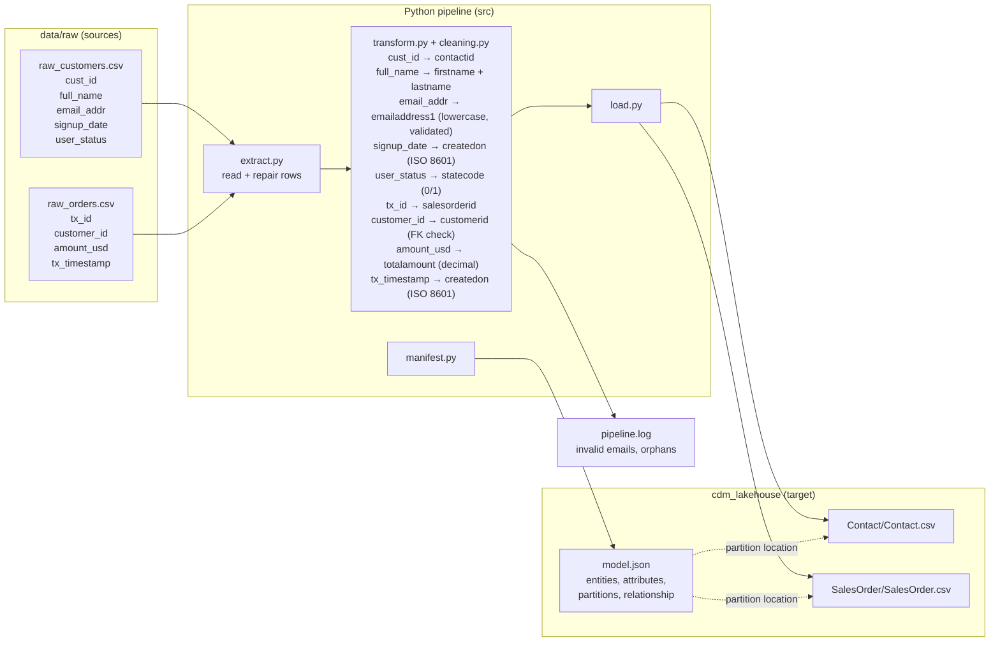
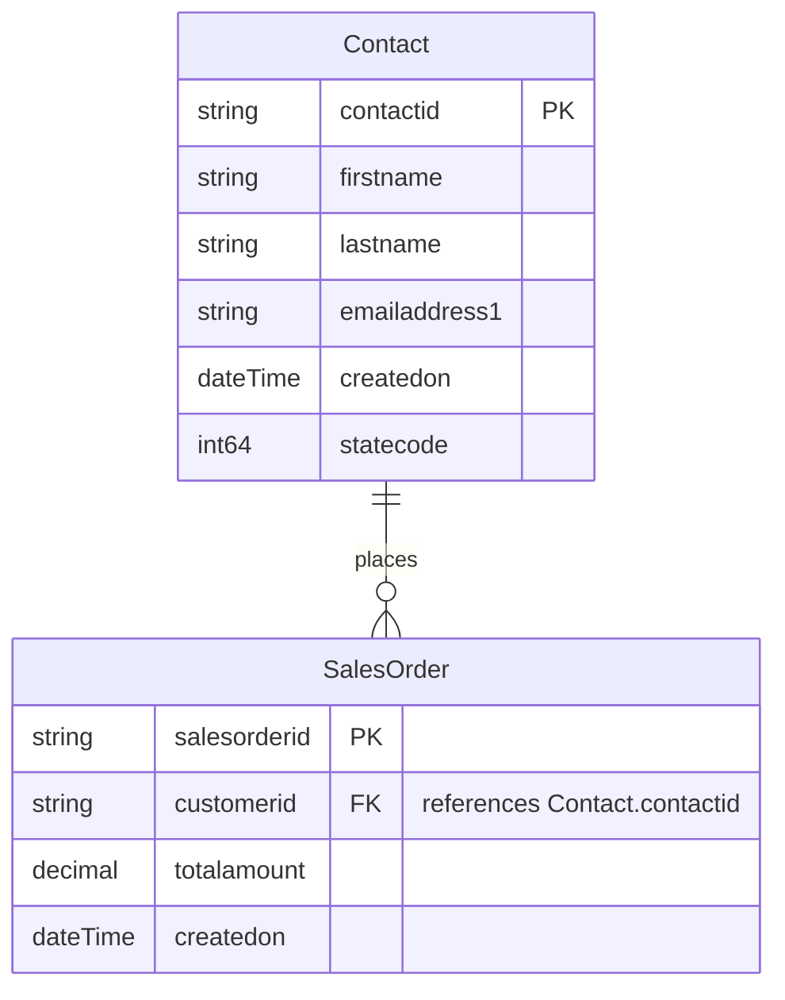

# CDM Ingestion Pipeline (reeeliance case study)

A lightweight Python pipeline that reads raw customer and order CSVs, cleans them,
maps them to the Microsoft Common Data Model (CDM) entities `Contact` and `SalesOrder`,
and writes them plus a `model.json` manifest into a lakehouse folder.

## Setup and run

Requirements: Python 3.9 or newer. No external packages (standard library only).

```bash
python3 src/main.py
```

Output:
- `cdm_lakehouse/Contact/Contact.csv`
- `cdm_lakehouse/SalesOrder/SalesOrder.csv`
- `cdm_lakehouse/model.json`
- `pipeline.log` (all warnings, e.g. invalid emails and orphan orders)

## Project structure

| File | What it does |
|---|---|
| `src/main.py` | Runs the steps in order: extract, transform, load, manifest |
| `src/extract.py` | Reads the raw CSVs and repairs rows broken over two lines |
| `src/cleaning.py` | Small functions that clean one value (name, email, date, status, amount) |
| `src/transform.py` | Maps raw rows to `Contact` and `SalesOrder`, checks the foreign key |
| `src/load.py` | Writes each entity into `cdm_lakehouse/<Entity>/<Entity>.csv` |
| `src/manifest.py` | Holds the target schema once and generates `model.json` from it |

## Data quality decisions

| Issue in raw data | Handling |
|---|---|
| `CST-005` is split over two lines | Detected (too few fields) and glued back together, logged |
| `invalid-email-format` (CST-003) | Logged, `emailaddress1` left empty |
| Uppercase email (CST-002) | Lowercased |
| Three different date formats | All normalized to `YYYY-MM-DDTHH:MM:SSZ`, assumed UTC; date-only becomes `00:00:00` |
| `ACTIVE` in uppercase | Status mapping is case-insensitive |
| Leading space in ` Charlie Brown` | Trimmed before splitting the name |
| Order `ORD-1005` points to `CST-999` | Orphan: logged and not loaded, so every `customerid` matches a `contactid` |

The schema is defined once in `manifest.py`. The CSV columns and `model.json`
are both generated from it, so they can never drift apart.

## Diagrams

### 1. Source-to-target mapping and storage layout



### 2. CDM entity relationship



One `Contact` can have zero or many `SalesOrder` records (1:N).
Each `SalesOrder` belongs to exactly one `Contact`.

## What I would add for production

- Run it in an orchestrator (e.g. Airflow or Azure Data Factory) instead of by hand
- Write to cloud storage (e.g. ADLS Gen2) instead of a local folder
- Keep orphan records in a quarantine folder so they can be fixed and reloaded
- Unit tests for each cleaning function
- Partition large entities by date (e.g. `SalesOrder/2023/06/...`)
